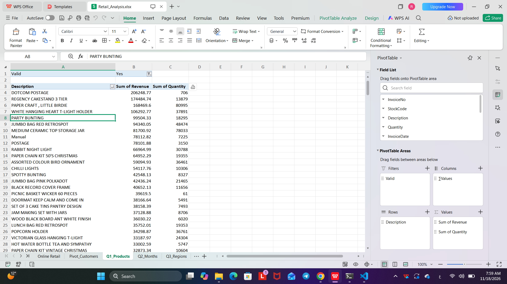
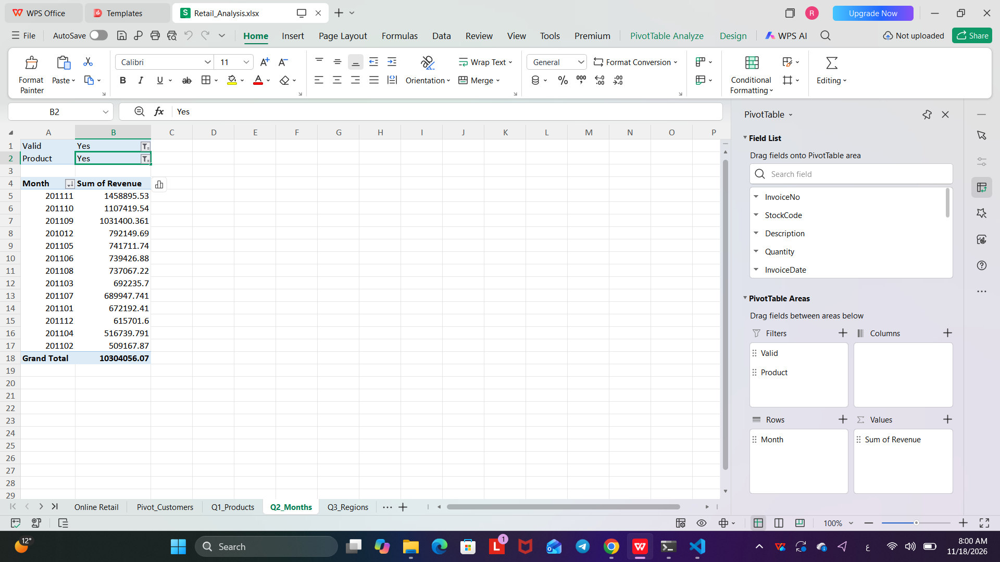

# Retail Sales Analysis (SQL + Excel)

An exploration of an online retail dataset using **MySQL** and **Excel**, answering five business questions: best products, best months, top regions, average order value, and repeat buyers.

## Dataset

[Online Retail](https://archive.ics.uci.edu/dataset/352/online+retail) from the UCI Machine Learning Repository (CC BY 4.0): transactions of a UK-based online gift retailer between 1 Dec 2010 and 9 Dec 2011.
541,909 rows and 25,900 invoices before cleaning.

The raw data file is not included in this repository. Download it from the link above.

## Tools

- MySQL 8.0 (MySQL Workbench): importing, cleaning, and querying the data
- Excel: summarising the results and showing the calculations

## Excel work (pivot tables)

The same 5 questions were answered again in Excel using pivot tables, and the results match the SQL.

- [Full Excel file (Google Drive)](https://docs.google.com/spreadsheets/d/1c7dKLfNoJ6ot5hub1p5FeZ1rou0TmmcO/edit?usp=sharing&ouid=101300294455966931067&rtpof=true&sd=true)

## Data cleaning

A view called `clean_retail` was created on top of the raw table, so the original data stays untouched:

- `InvoiceDate` converted from text to a real date
- `Revenue` column added (`Quantity x UnitPrice`)
- Cancelled invoices (`InvoiceNo` starting with `C`) removed
- Rows with zero or negative quantity or price removed
- After cleaning: 19,960 distinct invoices (orders)

For Q1 and Q2, non-product codes (postage, discounts, manual adjustments, bank charges) were also excluded.

## Results

| # | Question | Answer |
|---|----------|--------|
| 1 | Best product (by revenue) | REGENCY CAKESTAND 3 TIER, £174,485 (13,879 units) |
| 2 | Best month | November 2011, £1,458,896 from 2,751 orders |
| 3 | Top region | United Kingdom, £9,025,222. Netherlands is the top country outside the UK, £285,446 |
| 4 | Average order value | £534.40 (£10,666,685 over 19,960 orders) |
| 5 | Repeat buyers | 65.6% of customers (2,845 of 4,338) ordered more than once |

### Insights

- **Products:** REGENCY CAKESTAND earns the most with relatively few units, which means a high price per unit. PAPER CRAFT, LITTLE BIRDIE sells by far the most units (80,995), but this is probably inflated by one very large order that was later cancelled.
- **Months:** November 2011 leads because it has the most orders, not because each order is bigger. Its average order value is lower than in September and October. The autumn peak may be related to pre-holiday gift buying, but the data does not prove this.
- **Regions:** The UK accounts for most sales, as expected for a UK-based company. The Netherlands has only 94 orders but a high value per order, which may point to wholesale customers.
- **Customers:** The customer with the most orders (ID 12748) placed 209 orders.

## Assumptions and limitations

- Cancellations were excluded rather than subtracted, so the figures show gross sales, not net sales after returns.
- The data ends on 9 Dec 2011, so December 2011 is an incomplete month.
- Customers without a `CustomerID` are excluded from the repeat-buyer analysis because they cannot be tracked.
- Q3 and Q4 keep postage and other admin codes, because they are real payments by customers.
- Interpretations about wholesale customers and holiday seasonality are possible explanations, not facts shown by the data.

## Files

- `queries.sql`: setup, cleaning view, and all queries
- `Rana_Algendi_Retail_Sales_Analysis.xlsx`: summary and calculations for each question
- `sql/`: the original query files, one per question

## How to reproduce

1. Download the Online Retail data and convert it to CSV.
2. Run the setup section of `queries.sql` and import the CSV into `online_retail` (Table Data Import Wizard in MySQL Workbench).
3. Run the rest of `queries.sql` and compare with the results above.
